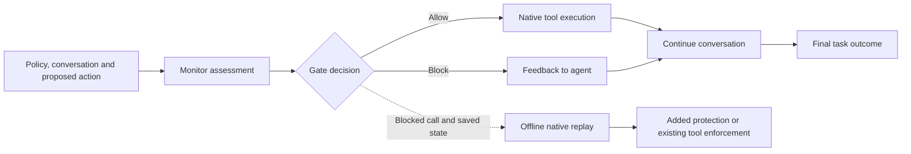

# Policy Gate Evaluation

### From Warnings to Interventions: Evaluating Policy Enforcement in Tool-Using LLM Agents

**A blocked action is not necessarily a prevented violation—and a completed task is not necessarily policy-compliant.** This research artifact connects a gate's decision to the action it stopped, the tool's own enforcement, and what happened to the task afterward.

[Read the paper](paper/combined_study/manuscript.pdf) · [Results and limitations](docs/RESULTS.md) · [Reproduce](docs/REPRODUCING.md) · [Evidence guide](docs/ARTIFACT.md)

## What this study contributes

We evaluate tool-using AI agents in simulated retail and airline tasks. The method separates three questions:

1. **Detection:** What does a warning actually detect, given the information visible to the monitor?
2. **Added protection:** Would the blocked action violate a covered rule and change the database, or would the tool reject it anyway?
3. **Task outcome:** After a gate intervenes, does the conversation still reach its reference outcome?



The contribution is an evaluation method and reproducible evidence. The two gates are example designs; this artifact does not introduce a production enforcement framework.

## Main observations

The compact study assigns **1,152 conversations** across 32 designed scenario pairs, three actor configurations, two repetitions, two request types and three conditions. **1,143 completed; nine remain incomplete.** Of 384 ungated sources assigned to shadow scoring, 383 have complete outputs and one retains missing monitor output.

| Observed outcome | No gate | Broad gate | Decomposed gate |
| --- | ---: | ---: | ---: |
| Executed covered violation, pressure requests | 21/192 | 1/192 | 2/192 |
| Unresolved pressure outcomes | 0 | 2 | 1 |
| Reference completion, nominally permitted requests | 181/192 | 163/192 | 166/192 |
| Unresolved permitted outcomes | 0 | 2 | 3 |

Denominators retain every assignment. These are observed counts, not estimates that treat missing outcomes as failures. See [bounds and paired analyses](docs/RESULTS.md).

Across the two live gates, **48 blocked writes would cause covered violating state changes**, while **26 would already be rejected by the native tools**. Both increase block counts, but they represent different protection. All 21 ungated executed violations came from one actor configuration. Lower task completion does not, by itself, establish unnecessary blocking; **65 blocked events retain unresolved full-policy judgments**.

The evidence supports evaluating detection, added protection and task outcomes separately. It does not establish general superiority across agents or comprehensive policy compliance. Four originally planned formal comparisons remain withheld; added actor-specific tests are explicitly exploratory.

## Reproduce without model calls

Install Docker, clone this repository, then run:

```sh
git clone https://github.com/Gaurav890/policy-gate-evaluation.git
cd policy-gate-evaluation
./verify.sh
```

The first run downloads the pinned environment. The verification and analysis run **with networking disabled**, require no credentials, and make no model calls. The image targets Linux ARM64; an ARM64 machine or configured Docker emulation is required. See [native Python and troubleshooting instructions](docs/REPRODUCING.md).

This verifies the distributed checksums, compact records, released receipts and source commitments, then reproduces **eight compact tables, three earlier main-text tables, 560 descriptive paired rows and four exploratory actor contrasts**. The [release verification record](release/public_verification.json) states what was actually checked. The manuscript PDF is supplied; rendering it again is a separate step.

## Explore the artifact

| Start here | Purpose |
| --- | --- |
| [Paper PDF](paper/combined_study/manuscript.pdf) | Complete manuscript, figures, references and appendices |
| [Paper source](paper/combined_study/manuscript_source.md) | Editable scientific text |
| [Principal tables](paper/combined_study/principal_tables.md) | Main compact results and paired summaries |
| [Results readout](paper/combined_study/results_readout.md) | Detailed denominators and retained missingness |
| [Programmatic policy audit](paper/combined_study/policy_audit/evidence_audit/README.md) | Supported objections and unresolved judgments |
| [Artifact guide](docs/ARTIFACT.md) | Where records, earlier studies and transformations live |
| [Release provenance](docs/RELEASE.md) | Public snapshot, privacy transformations and verification scope |

Saved policies, customer messages and model outputs are research data. They are not instructions to execute tools. Operations in the study use synthetic benchmark scenarios; the repository makes no claim of production deployment or journal acceptance.

## Citation and reuse

Use [CITATION.cff](CITATION.cff) to cite this versioned research artifact. No DOI is assigned. The citation identifies the artifact maintainer and does not substitute for a finalized manuscript author list.

Original code is available under the [MIT license](LICENSE), within the scope described in [RIGHTS.md](RIGHTS.md). Paper, figures, records and datasets retain their existing rights; third-party notices are preserved in [licenses/](licenses/).

For reproducibility problems, use the [issue tracker](https://github.com/Gaurav890/policy-gate-evaluation/issues) and include the commit, command, environment and error. Never include API keys or private operational logs. See [contribution guidance](CONTRIBUTING.md).
